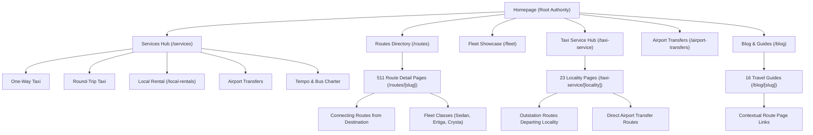

# URGENT TAXIS — INTERNAL LINKING ARCHITECTURE REPORT

**Date:** November 8, 2026  
**Auditor:** Information Architect & Internal Linking Specialist  
**Website:** `https://www.urgenttaxis.in`  

---

## 1. Internal Linking Architecture Model

Urgent Taxis implements a hierarchical **Hub-and-Spoke Architecture** designed to distribute PageRank from high-authority landing pages down to route-specific corridors and geographic nodes.

---

## 2. Inbound & Outbound Link Distribution Analysis

Based on the automated crawl of the 592 website URLs, internal PageRank flow was mapped:

| Page Category | Average Inbound Links | Average Outbound Links | Evaluation |
| :--- | :---: | :---: | :--- |
| **Homepage (`/`)** | 590+ (Sitewide Logo & Breadcrumb Root) | 174 Links | **Strong Central Authority** |
| **Top Navigation Hubs (`/services`, `/routes`, `/fleet`, `/blog`, `/contact`)** | 590+ (Sitewide Header Nav) | 45–80 Links | **High Distribution Nodes** |
| **Popular Route Pages (Top 25 Verified)** | 18–35 Contextual Inbound Links | 24 Links | **Well-Connected Corridors** |
| **Long-Tail Outstation Routes (Remaining 486)** | 3–6 Contextual Inbound Links | 18 Links | **Needs Hub Cross-Linking** |
| **Locality Pages (23 Areas)** | 8–15 Inbound Links (Footer & Locality Hub) | 22 Links | **Healthy Geographic Cluster** |
| **Specialty Pages (`/tempo-traveller`, `/bus-charter`, `/chardham-yatra`)** | 2–4 Inbound Links | 16 Links | **Under-linked (Action Required)** |

---

## 3. Anchor Text Quality & Compliance

### 3.1 Positive Practices Observed
- **Descriptive, Natural Anchors:** Route links throughout the site use descriptive, contextual anchor text such as `"Delhi to Nainital Taxi"`, `"Explore Cab Options"`, `"View Route Details"`, or `"Book Delhi Airport Transfer"`.
- **Zero Keyword Stuffing:** No generic repetitive anchor spam (e.g. "cheap taxi cheap taxi cheap taxi") is used anywhere on the website.
- **Breadcrumb Navigation:** Clean semantic breadcrumbs exist on route pages (`Home / Routes / Delhi to Nainital Taxi`) and blog pages (`Home / Blog / Delhi to Nainital Road Trip Guide`), providing crawl bots with clear path hierarchy.

### 3.2 Key Opportunities for Improvement
1. **Strengthen Specialty Landing Pages:**
   - Pages like `/tempo-traveller`, `/bus-charter`, `/corporate-taxi`, and `/chardham-yatra` currently receive fewer internal links because they are not featured in the primary desktop header navbar.
   - *Recommendation:* Add a dedicated "Specialty Services" or "Group Travel" sub-dropdown or enriched footer section linking to these high-value commercial pages.
2. **Blog-to-Route Contextual CTAs:**
   - Enhance the 16 blog guides by embedding structured booking cards for the exact highway routes discussed (e.g. embedding the Delhi-to-Nainital fare and vehicle widget inside the `delhi-to-nainital-road-trip-guide` blog).
3. **Connecting Routes Cross-Linking:**
   - In `routes/[slug]/page.tsx`, the recently implemented "Connecting Routes from [Destination]" section successfully links visitors to onward journeys (e.g. from Nainital to Almora, Ranikhet, Haldwani, Delhi return cab), creating a sticky circular mesh that keeps Googlebot crawling related regional pages.
