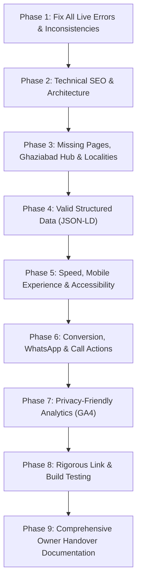

# URGENT TAXIS — SEO, CONTENT & CONVERSION OVERHAUL
## Master Implementation Plan & Architecture Specification

**Target Branch:** `seo-overhaul`  
**Base Commit:** `817297b` (Clean branch from `main`)  
**Production URL:** `https://www.urgenttaxis.in`  
**Execution Mode:** Local Development & Verification (Zero Production Deploys)

---

### Executive Overview & Primary Objectives
Urgent Taxis is a 24/7 outstation taxi, local rental, and airport transfer service based in Masuri, Ghaziabad, Uttar Pradesh. The objective of this overhaul is to achieve top organic rankings for high-intent taxi queries in Ghaziabad, Delhi NCR, and key North Indian travel corridors, while eliminating all technical errors, brand duplication bugs, hardcoded pricing contradictions, and trademark risks.

---

### Core Operating Principles & Hard Constraints
1. **Source of Truth & Single Config:** All phone numbers, addresses, rates, package dimensions, hours, and policies will be consolidated in `frontend/lib/config.ts`. No business facts will be hardcoded in UI components.
2. **Never Fabricate Facts:** No invented reviews, ratings, customer numbers ("10,000+"), awards, or fake testimonials. Missing information is handled via `null`/omission and documented in `/docs/OWNER-TODO.md`.
3. **Protected Brand Identity & Credits:**
   - Brand Colors: Navy Blue (`#1a419c` / `#0b101e`) and Brand Green (`#00a859`).
   - Official Logo: `/logo.jpg` used as-is.
   - Tagline: *"Fast To Your Destination — Your Quick Ride Solution!"*
   - Hindi Tagline: *"हमेशा आपके साथ!"*
   - Protected Footer Designer Credit in `frontend/components/public/Footer.tsx`:
     ```html
     <div className="footer-designer-credit">
       <span>Designed by </span>
       <strong>Mantsha Khan</strong>
     </div>
     ```
4. **100% Original Content:** Authentic, helpful local guides for Ghaziabad and NCR localities, transparent route fare breakdowns, and comprehensive blog guides. No copied competitor text or logos.

---

### Phase-by-Phase Roadmap



---

### Phase 1: Live Site Error Resolution
- **Footer Top Routes Links:** Update `/routes/<from>-to-<to>` to `/routes/<from>-to-<to>-taxi`. Add permanent 301 redirects in `next.config.mjs` for all legacy pattern URLs.
- **Link Auditing & Creation:** Ensure `/faq`, `/about`, `/contact`, `/reviews`, `/privacy`, `/terms`, `/routes`, `/fleet/*`, and all services return HTTP 200.
- **Title Template Deduplication:** Fix layout title template and `constructMetadata` so the brand name `| Urgent Taxis` is never duplicated.
- **Encoding & Rupee Character Restoration:** Replace all 218 instances of corrupted characters (`Γé╣`) in `processed-master-routes.json`, `master-routes.json`, and components with clean UTF-8 `₹`. Add `<meta charSet="utf-8" />`.
- **Live Route Map Replacement:** Replace static logo image with a keyless OpenStreetMap / Leaflet embedded route schematic with lazy loading and descriptive title.
- **Social Media Links:** Link to verified profiles from config; conditionally hide icons when profiles are undefined or unverified.
- **Clean WhatsApp Message:** Eliminate `FOOTER`, markdown symbols, and unformatted lines. Generate clean, polite plain text with trip type, route, car, and request confirmation.
- **Price Consistency & Breakdown:** Remove hardcoded card values (`₹2889 + ₹245`, `SAVE 20%`). Connect all cards, widgets, and schemas to the central pricing dataset with clear itemization: Base Fare, Estimated Toll, Estimated State Tax, and Final Estimated Price.
- **Remove Competitor Badges:** Remove MakeMyTrip, Goibibo, EaseMyTrip, Savaari, Justdial, and TripAdvisor logos from `TrustSection.tsx`. Replace with an authentic "Why Book Direct" section.
- **Replace Keyword-Stuffed Paragraph:** Replace the dense bold keyword paragraph with natural, helpful copy and internal navigation links.
- **Footer Scope:** Update "across India" to "Ghaziabad, Delhi NCR and North India".
- **Homepage Fleet Duplication:** Eliminate duplicate looping array items in the fleet slider.
- **Airport Pickup Guide Isolation:** Render the IGI Airport terminal pickup guide only on actual airport routes.
- **Meta Description & Title Length:** Enforce <= 155 characters for descriptions and <= 60 characters for titles.
- **Canonical Domain & Favicons:** Configure `https://www.urgenttaxis.in` as the absolute canonical. Add full favicon sets and `<html lang="en-IN">`.

---

### Phase 2: Technical SEO Architecture
- **Dynamic Sitemap:** `frontend/app/sitemap.ts` generating canonical URLs with `lastModified` across core pages, fleet categories, 490+ outstation routes, 20 locality hubs, and blog articles.
- **Robots Configuration:** `frontend/app/robots.ts` referencing sitemap and disallowing `/admin/`.
- **Canonical & Security Headers:** Enforce HSTS, X-Content-Type-Options, Referrer-Policy, Frame protection, and disable `X-Powered-By`.
- **Custom Error Pages:** Informative `not-found.tsx` (404) and `error.tsx` offering clear navigation paths back to core services.

---

### Phase 3: Content Expansion (Ghaziabad First)
- **Central Business Configuration (`frontend/lib/config.ts`):** Complete single-file data repository for all contact details, addresses, baseline rates, and policies.
- **Ghaziabad Locality Hub (`/taxi-service/ghaziabad`):** High-authority primary hub celebrating local Ghaziabad hubs (Old Bus Stand, Anand Vihar border, Mohan Nagar, New Bus Adda Metro).
- **19 Dedicated Locality Pages (`/taxi-service/[locality]`):**
  1. Masuri (Headquarters)
  2. Indirapuram
  3. Vaishali
  4. Vasundhara
  5. Raj Nagar
  6. Raj Nagar Extension
  7. Kaushambi
  8. Sahibabad
  9. Crossings Republik
  10. Loni
  11. Modinagar
  12. Muradnagar
  13. Hapur
  14. Meerut
  15. Noida
  16. Greater Noida
  17. Delhi
  18. Faridabad
  19. Gurugram
  *Each page containing 600+ words of verified local landmarks, station details, route fare tables, and local FAQs.*
- **Key Route Expansions:** Ghaziabad and Noida to top religious, hill station, and commercial destinations (Haridwar, Rishikesh, Dehradun, Nainital, Haldwani, Kainchi Dham, Agra, Jaipur, Shimla, etc.).
- **Airport Pages:** Dedicated Ghaziabad to Delhi Airport and Noida to Delhi Airport transfer landing pages.
- **Trust Pages:** Dedicated `/faq` and `/booking-policy` pages.
- **12 Original High-Authority Blog Posts:** 1,000+ words each on regional travel tips, Kanwar Yatra road advice, Char Dham planning, airport taxi timings, and fare transparency.

---

### Phase 4: Structured Data (JSON-LD)
- `Organization` & `TaxiService` (LocalBusiness) with accurate geo coordinates, operating hours (24/7), telephone, address, and service areas.
- `BreadcrumbList` on all interior pages.
- `Service` & `Offer` schemas in INR tied directly to data files.
- `FAQPage` on pages with visible Q&A.
- `BlogPosting` on all blog articles.

---

### Phase 5 & 6: Performance, Mobile & Conversion
- Mobile-first sticky bottom action bar with direct Call (`tel:+917310651940`) and WhatsApp consultation.
- Image optimization using WebP/AVIF formats and responsive `sizes` attributes.
- Tap targets >= 48px, WCAG AA color contrast, and proper form labeling.

---

### Phase 7: Privacy-Friendly Analytics
- Lightweight Google Analytics 4 integration via `NEXT_PUBLIC_GA_ID` env variable.
- Custom event tracking for phone clicks, WhatsApp conversations, and booking submissions.
- Search Console verification retention.

---

### Phase 8 & 9: Verification & Documentation
- Comprehensive automated link crawler (`scripts/check-links.mjs`) ensuring 100% HTTP 200 responses.
- Next.js production build (`npm run build`) verification with 0 errors.
- Handover documentation:
  - `/docs/SEO-CHANGES.md`
  - `/docs/OWNER-TODO.md`
  - `/docs/LOCAL-SEO-CHECKLIST.md`
  - `/docs/HOW-TO-ADD-A-ROUTE.md`
  - `/docs/KEYWORD-MAP.md`
